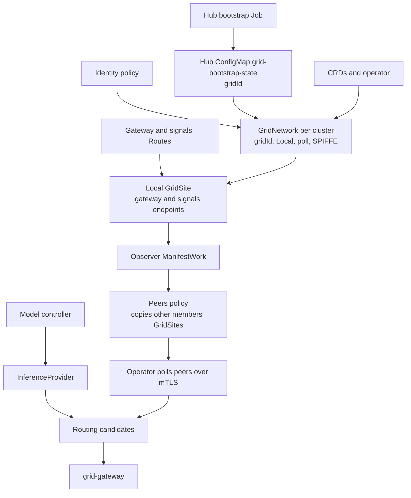

# Grid ACM hub install

How a cluster becomes a Grid site on v0.3.0-rc.2, under Local membership with ACM delivery. One site per cluster.

## Flow



1. Bootstrap writes the grid ID once to grid-bootstrap-state on the hub.
2. A policy delivers each cluster's site identity and CA. The site name is the managed cluster name.
3. Once the CRDs are Established and the Secrets exist, a policy creates the GridNetwork: grid ID, Local, poll, SPIFFE.
4. A policy writes the local GridSite with endpoints from the admitted Routes.
5. The observer reads each GridSite back to the hub, and the peers policy copies it to the other members.
6. The operator polls each declared peer. Local and remote providers become the gateway's candidates. Remote picks go to the site's gateway, local picks to the provider endpoint.

## Installing Argo CD

Argo CD runs on the hub and installs everything else from the tenant repo, ACM included. As cluster-admin on the hub:

```bash
oc login --server=https://api.<hub-cluster-domain>:6443 -u <cluster-admin>
git clone https://github.com/kahowell/ai-grid-tenant.git
cd ai-grid-tenant
export RHOAI_QUAY_PULL_SECRET=<base64 of user:password for quay.io/rhoai>
./bootstrap.sh
```

bootstrap.sh installs the openshift-gitops-operator Subscription, waits for the Argo CRDs, and applies a root ApplicationSet over apps/*/application.yaml. Argo then syncs every app from main.

## Installing ACM

Delivered by the acm Argo app ([apps/acm/manifests](../../../apps/acm/manifests), ACM 2.17.3), in namespace open-cluster-management:

1. OperatorGroup targeting open-cluster-management.
2. Subscription advanced-cluster-management, channel release-2.17, source redhat-operators.
3. MultiClusterHub with an empty spec. The hub registers itself as local-cluster.
4. A ManagedClusterSetBinding for global, a Placement over global, and ClusterManagementAddOns governance-policy-framework and config-policy-controller installed through that Placement. Every cluster then runs policies, the hub included.
5. Import each spoke. It joins the global set. See [cluster onboarding](../cluster-onboarding/README.md):

```bash
docs/acm/cluster-onboarding/import-managed-cluster.sh --spoke-context <spoke> --cluster-name <name>
```

## Setting up a hub

The hub manages the grid: CA, grid ID, policies. It needs no Grid CRDs. Running Grid workloads on it is optional.

Needs ACM as above and cert-manager. The RHOAI app installs cert-manager on the hub, so a hub that is not a site installs it separately.

Install grid-enrollment on the hub with the grid-bootstrap app. Its values, [apps/grid-bootstrap/values.yaml](../../../apps/grid-bootstrap/values.yaml):

```yaml
mode: external
gridIdentity:
  enabled: true
grid:
  membership:
    source: Local
managedClusters:
  enabled: true
  networkName: grid
  clusterSet: global
  clusterLabel: ai-grid/enabled
  clusterLabelValue: 'true'
  createClusterSetBinding: false
  hubClusterName: local-cluster
external:
  delivery:
    namespace: redhat-ai-grid
  certManager:
    enabled: true
    issuer:
      create: true
      name: grid-ca
    ca:
      mode: Existing
      secretName: grid-ca-key
```

The lab keeps its CA with mode Existing. A new grid uses mode Generate.

Nothing else to run. The root ApplicationSet picks up [apps/grid-bootstrap/application.yaml](../../../apps/grid-bootstrap/application.yaml), which installs the chart on the hub with these values. Change them by committing to this file.

Onboard a cluster by labelling its ManagedCluster. Unlabelling withdraws it but keeps its GridNetwork.

The hub is a site only if labelled. Proposed: managedClusters.includeHub, default false, excludes the hub from membership whatever its labels.

Verify: membership policies Compliant, each member's GridNetwork Active with the grid ID.

## Dedicated hub

A dedicated hub runs ACM, cert-manager and grid-enrollment, and no Grid or RHOAI workloads. Bootstrap it with the dedicated-hub profile:

```bash
BOOTSTRAP_PROFILE=dedicated-hub ./bootstrap.sh
```

Its root ApplicationSet, [bootstrap/dedicated-hub/applicationset.yaml](../../../bootstrap/dedicated-hub/applicationset.yaml), syncs acm, cert-manager, gitops-config, grid-bootstrap and rhoai-prerequisites. ACM gets [core](../../../apps/acm/manifests/core) only, since observability needs object storage and Submariner needs a site. The default ApplicationSet skips [apps/cert-manager](../../../apps/cert-manager), because on a combined hub the RHOAI app installs cert-manager.

grid-bootstrap still needs ClusterSet global bound into redhat-ai-grid, which the RHOAI app does today. Until grid-bootstrap takes that binding over, set managedClusters.createClusterSetBinding to true in its values on a dedicated hub. A new grid also sets external.certManager.ca.mode to Generate.

rhoai-prerequisites delivers the quay.io/rhoai mirror and pull Secret to every cluster in global, the hub included. The grid-enrollment image needs them, so a dedicated hub seeds the RHOAI Quay Secret like any other hub.

## Grid ID

Source: the hub ConfigMap. Copy: each cluster's GridNetwork spec.gridId, immutable. Consumers read the local GridNetwork. Back up the ConfigMap with the CA. Under Local it only gates readiness.

## Local membership

* Peers: the GridSites delivered to the cluster.
* Remote providers: polled from each peer's catalog.
* Admission: a certificate naming a declared GridSite.

The operator restarts into the mode its GridNetwork declares.

## Simplification candidates

* Three possible creators of the local GridSite: operator, grid-operator chart, policy.
* Endpoints are copied twice: Routes to local GridSite to peer copies.
* Everything keys on the managed cluster name, so one site per cluster.

## References

* Grid, v0.3.0-rc.2: https://github.com/praxis-proxy/grid/tree/v0.3.0-rc.2
* grid-enrollment chart: https://github.com/praxis-proxy/grid/tree/v0.3.0-rc.2/charts/grid-enrollment
* Vendored chart the lab installs: https://github.com/opendatahub-io/odh-gitops/tree/feature-ai-grid/charts/rhai-on-openshift-chart/charts/grid-enrollment
* Lab tenant: https://github.com/kahowell/ai-grid-tenant
* Argo bootstrap: https://github.com/kahowell/ai-grid-tenant/blob/main/bootstrap.sh
* ACM manifests: https://github.com/kahowell/ai-grid-tenant/tree/main/apps/acm/manifests
* Hub values: https://github.com/kahowell/ai-grid-tenant/blob/main/apps/grid-bootstrap/values.yaml
